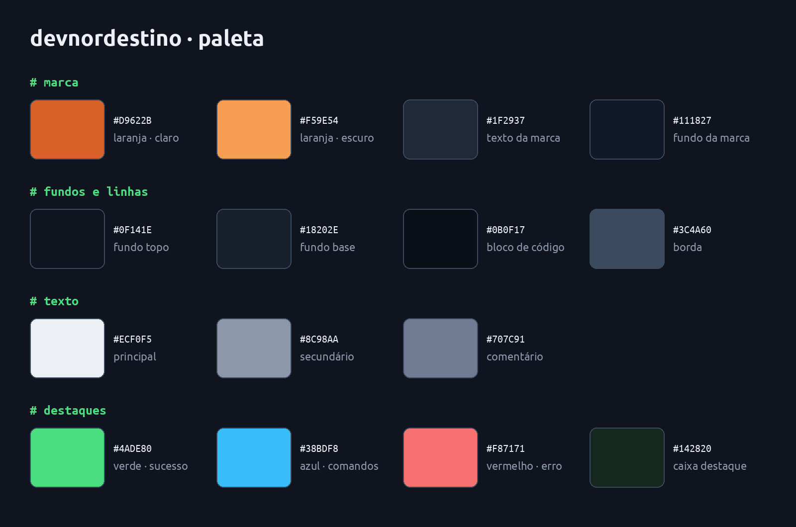

# Identidade visual · devnordestino

Guia para manter o mesmo padrão em artigos, capas e carrosséis.
Arquivos da logo: [`../logo/`](../logo/) · Paleta: [`palette.png`](palette.png) · Exemplos: [`examples/`](examples/) · Modelos: [`templates/`](templates/)

---

## 1. Marca

**devnordestino** é o agregador dos artigos de **Jefferson do Vale**: o nome sempre aparece ligado a ele.

| Versão | Quando usar |
|---|---|
| **Extensa** (símbolo + nome + "by Jefferson do Vale") | Último slide, página "sobre", apresentações |
| **Reduzida** (símbolo + nome) | Capa do carrossel, capa de artigo, topo do site |
| **Ícone** (só o símbolo) | Slides internos, avatar, marca d'água |
| **Ícone em bloco** | Favicon, ícone de app, avatar redondo |

Regras:
- Use sempre a versão `-dark` em fundo escuro e a `-light` em fundo claro. Nunca recolorir.
- A assinatura "by Jefferson do Vale" aparece **só na versão extensa**. Em tamanho pequeno ela fica ilegível.
- **Tamanho mínimo:** reduzida com 64px de altura num slide de 1080px, ou 32px numa capa de 420px. Abaixo disso o nome não dá para ler; use só o ícone.
- Respiro: deixe em volta da logo um espaço livre de pelo menos a largura de um `<` do símbolo.
- Uma logo por peça. Se a logo grande já aparece no conteúdo (último slide), tire a do cabeçalho.
- Usar o mesmo nome ("Jefferson do Vale") no LinkedIn, no dev.to e na assinatura.

## 2. Cores



**Laranja é da marca; verde e azul são do conteúdo.** O laranja aparece só na logo. Destaques dentro do conteúdo usam verde/azul, para a logo não competir com o texto.

| Papel | Cor | Uso |
|---|---|---|
| Fundo | `#0F141E` → `#18202E` | Gradiente vertical + grade de pontos `#1E2838` a cada 30px |
| Cartão / caixa | `#18202E` com borda `#3C4A60` | Listas, itens, diagramas |
| Bloco de código | `#0B0F17` | Com os 3 pontinhos de janela (vermelho, amarelo, verde) |
| Caixa de destaque | `#142820` com borda `#4ADE80` | A resposta, a solução, o "✓" |
| Texto principal | `#ECF0F5` | Títulos e texto de leitura |
| Texto secundário | `#8C98AA` | Descrições, subtítulos, rodapé |
| Comentário | `#707C91` | Só `# comentários` dentro de código |
| Verde | `#4ADE80` | Palavra-chave do título, `$` do prompt, kicker, sucesso |
| Azul | `#38BDF8` | Comandos citados, linhas do diagrama, "arrasta →" |
| Vermelho | `#F87171` | Erro, ✗, sintoma ruim |

Regra de contraste: texto pequeno sempre com contraste **≥ 4,5:1** sobre o fundo. O `#707C91` só passa nesse limite dentro do bloco de código (4,5:1 sobre `#0B0F17`). Sobre o fundo normal ele cai para cerca de 3,9:1, por isso fica restrito a comentários de código.

## 3. Tipografia

Todas são fontes livres do Ubuntu (`fonts-ubuntu`).

| Fonte | Uso |
|---|---|
| **Ubuntu Bold** | Títulos |
| **Ubuntu Medium** | Subtítulos, frases de impacto |
| **Ubuntu Regular** | Texto corrido, descrições |
| **Ubuntu Mono (Regular/Bold)** | Código, comandos, kicker (`# tema`), rótulos, contador |
| **DejaVu Sans Mono Bold** | Só para a seta `→` (a Ubuntu não tem esse caractere) |

Padrão de destaque no título: **uma** palavra ou trecho em verde, nunca mais que isso.

## 4. Formatos

| Peça | Tamanho | Observação |
|---|---|---|
| Capa dev.to | **1000×420** | Enviar pelo botão "Add a cover image" |
| Capa Medium | **1400×788** (16:9) | Primeira imagem do post vira a capa |
| Carrossel Instagram/LinkedIn | **1080×1350** (4:5) | Instagram: PNGs · LinkedIn: **PDF** como "documento" (com imagens soltas ele mostra uma grade) |

### Escala de texto do carrossel (1080px de largura)

No celular, o slide aparece com ~36% do tamanho. **Nenhum texto abaixo de 30px.**

| Elemento | Tamanho | Fonte |
|---|---|---|
| Título da capa | 92px | Ubuntu Bold |
| Título dos slides | 62–84px | Ubuntu Bold |
| Subtítulo / frase de impacto | 42–54px | Ubuntu Medium |
| Kicker (`# o problema`) | 34px | Ubuntu Mono Bold, verde |
| Nome de item / comando | 34–42px | Ubuntu Mono Bold |
| Descrição / texto de apoio | 32px | Ubuntu Regular, cinza secundário |
| Código | 31–36px | Ubuntu Mono |
| Rodapé, contador, "arrasta" | 30–32px | Ubuntu Mono |

### Escala da capa (1000×420; na de 1400×788 tudo escala pela altura)

| Elemento | Tamanho |
|---|---|
| Título | 44px Bold, 2 linhas |
| Subtítulo | ~27px Medium |
| Prompt no topo (`$ comando  # detalhe`) | 18px Mono verde |
| Tags | 15px Mono Bold azul, em caixinhas |
| Logo reduzida | 32px de altura, canto inferior direito, centralizada com as tags |

Margem: 90px no carrossel e 48px na capa. Conteúdo do carrossel começa em y=230.

## 5. Estrutura das peças

### Capa
```
$ comando-do-tema   # detalhe              ┌──────── diagrama ────────┐
Título em 2 linhas                         │  do assunto, com caixas  │
subtítulo com UMA palavra verde            │  e linhas tracejadas     │
#tag #tag #tag #tag                        └──────────── [logo] ──────┘
```

### Slide do carrossel
```
[ícone]                                   04/09    ← cabeçalho (na capa: logo reduzida)

# kicker                                           ← verde, mono
Título com destaque                                ← bold
conteúdo: lista, código, diagrama ou caixas

série/tema                           arrasta →     ← rodapé (o último slide não tem "arrasta")
```

### Roteiro padrão de carrossel (7 a 10 slides)
1. **Gancho**: o título do artigo, mais um visual
2. **O problema**: a dor, de um jeito que o leitor se identifique
3. **O que foi descartado**, com ✗ e ✓
4. **A ideia**, numa frase de impacto e num diagrama
5. **Como fazer** (1 a 2 slides, só o essencial)
6. **O perrengue**: o troubleshooting, a parte que mais gera identificação
7. **A lição**
8. **Chamada final**: "artigo completo no dev.to" + "link nos comentários / na bio" + logo extensa

O carrossel é um **trailer**: mostra o caminho, e o artigo entrega os detalhes.

## 6. Texto e tom

- **Primeira pessoa**, informal, com humor ("bazuca para matar mosca", "gosto de arrumar problema").
- **Honestidade** sobre erros e o que não deu para confirmar. Funciona melhor do que parecer infalível.
- Títulos no formato **dor + solução**: "Cansei de X: fiz Y".
- Estrutura do artigo: Introdução → O que considerei → Pré-requisitos → Cenário → Passos numerados → Testando → Resolução de problemas → Limitações → Conclusão.
- Tabelas para opções de config, para comparar alternativas e para "sintoma → causa".
- Notas com emoji em citação: `> 💡 Dica`, `> ⚠️ Atenção`, `> 🤓 Curiosidade`.
- **Comando em imagem precisa funcionar se copiado** (ex.: o fstab não expande `~`, então use o caminho completo).

## 7. Publicação

| Onde | O quê | Detalhe |
|---|---|---|
| dev.to | Artigo completo | No máximo 4 tags, minúsculas · série no front matter · `published: false` até revisar |
| Medium | Mesmo artigo | Capa 16:9 como primeira imagem |
| LinkedIn | Carrossel em PDF + legenda | Link do artigo **nos comentários** |
| Instagram | Carrossel em PNG + legenda curta | Link **na bio** (link na legenda não é clicável) · mais hashtags |

Modelo de legenda: [`../../_template/captions.md`](../../_template/captions.md) · exemplo real: [`../../posts/2026-11-nfs-home-server/captions.md`](../../posts/2026-11-nfs-home-server/captions.md)

## 8. Organização de pastas

```
articles/                         # repo git
├── brand/
│   ├── logo/                     # svg, png, favicon, source/generate.py
│   └── visual-identity/          # este guia, palette.png, examples/, templates/
├── _template/                    # copiar para começar um post novo
└── posts/
    └── AAAA-MM-<slug>/           # ex.: 2026-11-nfs-home-server
        ├── article.md            # o artigo (front matter do dev.to)
        ├── README.md             # mapa do post: status, links, imagens e como foram geradas
        ├── captions.md           # legendas LinkedIn / Instagram
        └── images/
            ├── cover/            # cover.py → cover-devto.png, cover-medium.png
            └── carousel/         # carousel.py → slide-NN.png, carousel.pdf
```

## 9. Gerando as peças do próximo post

Os modelos em [`templates/`](templates/) são os scripts do post de NFS, para copiar e adaptar.
Eles acham a logo sozinhos (procuram a pasta `brand/` acima deles), então funcionam em qualquer PC.

```bash
# uma vez só por PC
python3 -m venv --system-site-packages ~/.venvs/arte && ~/.venvs/arte/bin/pip install cairosvg

# por post (a partir da raiz do repo)
P=posts/AAAA-MM-<slug>
cp -r _template $P
cp brand/visual-identity/templates/cover.py    $P/images/cover/
cp brand/visual-identity/templates/carousel.py $P/images/carousel/
# edite textos/diagrama e gere (sem argumento, a saída vai para a pasta do script):
~/.venvs/arte/bin/python $P/images/cover/cover.py
~/.venvs/arte/bin/python $P/images/carousel/carousel.py
```

- `cover.py`: troque o prompt, o título, o subtítulo, as tags e os nomes do diagrama.
- `carousel.py`: cada slide é uma função (`s1`, `s2`, ...). Os auxiliares (`title`, `kicker`, `code`, `box`, `mark`, `diagram`) já seguem este guia.
- Anote no `README.md` do post o que mudou em relação ao modelo.

## Checklist antes de publicar

- [ ] Nenhum texto abaixo de 30px no carrossel
- [ ] Uma palavra em verde por título, no máximo
- [ ] Logo: reduzida na capa, ícone nos internos, extensa no último
- [ ] Comandos das imagens conferidos (funcionam se copiados?)
- [ ] Contador `NN/TT` certo e "arrasta" fora do último slide
- [ ] PDF gerado para o LinkedIn
- [ ] Legendas: link nos comentários (LinkedIn) / na bio (Instagram)
