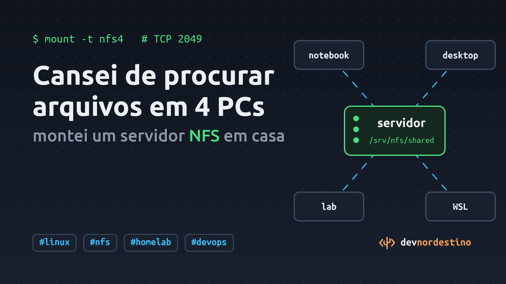
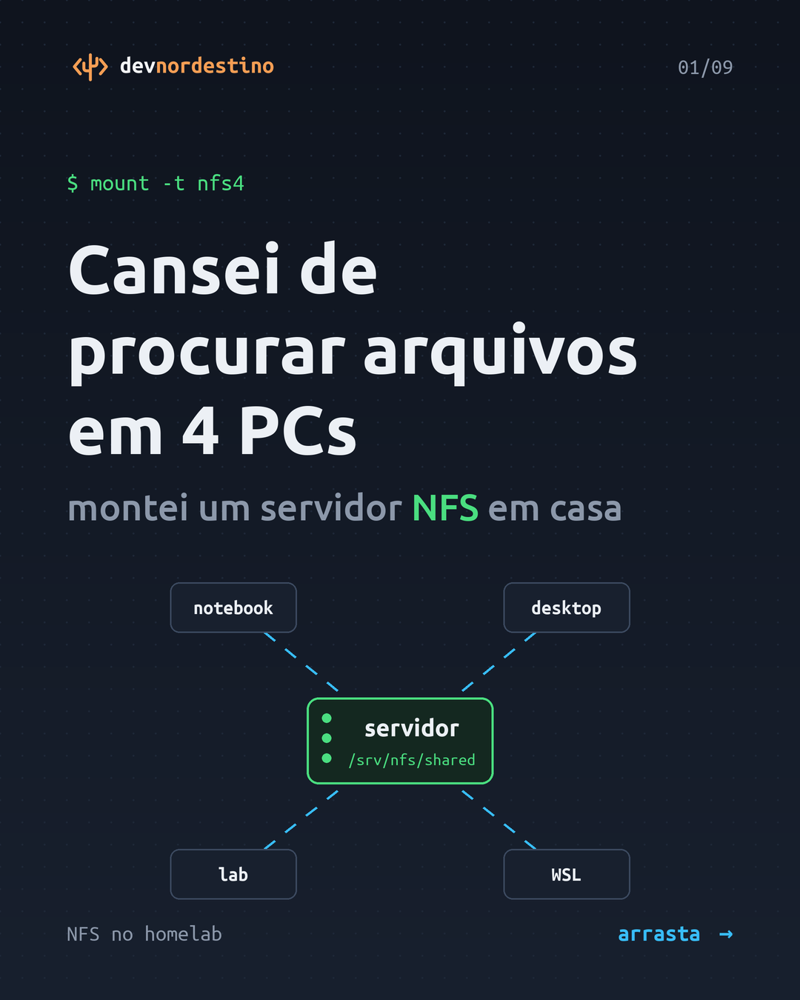
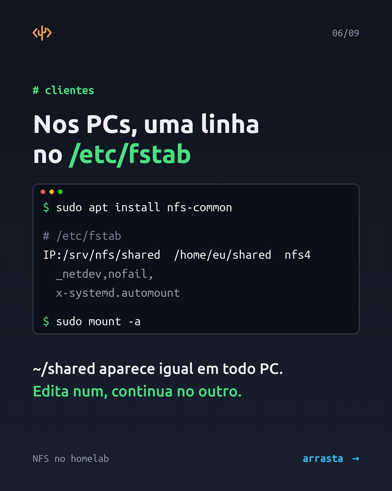
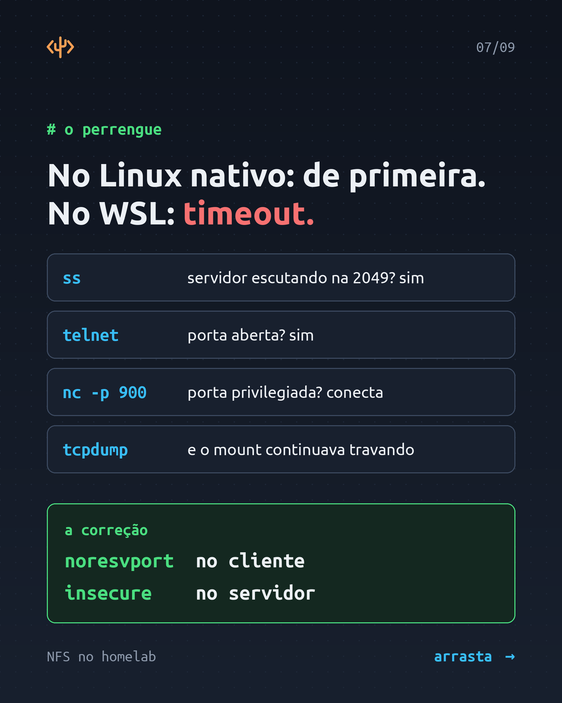

# Cansei de procurar arquivos em 4 PCs: montei um servidor NFS em casa



> Como transformei um Ubuntu Server ocioso em um servidor de arquivos com NFS para compartilhar projetos e
> anotações entre vários PCs, e o perrengue que tive para fazer o WSL enxergar a pasta.

📖 **Ler:** [no dev.to](https://dev.to/jefferson682/cansei-de-procurar-arquivos-em-4-pcs-montei-um-servidor-nfs-em-casa-1jh6) · [aqui no GitHub](article.md)

Publicado em 24/11/2026 · Série **Homelab na prática** · `linux` `homelab` `devops` `nfs` `wsl`

## Carrossel

Resumo do artigo em 9 slides ([PDF](images/carousel/carousel.pdf)).

<p>
  
  
  
  
  
  
  
  
  
</p>

---

## Bastidores

Como as peças deste post foram produzidas.

| | |
|---|---|
| Status | publicado |
| dev.to | [link](https://dev.to/jefferson682/cansei-de-procurar-arquivos-em-4-pcs-montei-um-servidor-nfs-em-casa-1jh6) (canonical) |
| Medium | — |
| LinkedIn | — |
| Instagram | — |

### Imagens

| Arquivo | Tamanho | Gerado por | Template de origem |
|---|---|---|---|
| `images/cover/cover-devto.png` | 1000×420 | `images/cover/cover.py` | — (este post deu origem a `brand/visual-identity/templates/cover.py`) |
| `images/cover/cover-medium.png` | 1400×788 | `images/cover/cover.py` | idem |
| `images/carousel/slide-01..09.png` | 1080×1350 | `images/carousel/carousel.py` | — (deu origem a `brand/visual-identity/templates/carousel.py`) |
| `images/carousel/carousel.pdf` | 9 páginas | `images/carousel/carousel.py` | idem |

- **Capa**: prompt `$ mount -t nfs4   # TCP 2049`, título em 2 linhas ("Cansei de procurar / arquivos em 4 PCs"),
  diagrama do servidor exportando `/srv/nfs/shared` para os PCs, logo reduzida no canto inferior direito.
- **Carrossel** (9 slides): roteiro padrão do manual: gancho → problema → o que descartei → a ideia (diagrama) →
  configuração do servidor/cliente → perrengue do WSL → lição → chamada final com logo extensa.
- **Diferenças em relação ao template**: nenhuma. Os templates são cópia destes scripts.
- **Ajustes manuais**: nenhum.
- Legendas usadas no LinkedIn e no Instagram: [`captions.md`](captions.md).

### Regerar

```bash
# da raiz do repositório
~/.venvs/arte/bin/python posts/2026-11-nfs-home-server/images/cover/cover.py
~/.venvs/arte/bin/python posts/2026-11-nfs-home-server/images/carousel/carousel.py
```

Requisitos: Python 3, Pillow, cairosvg e as fontes Ubuntu (`fonts-ubuntu`).
